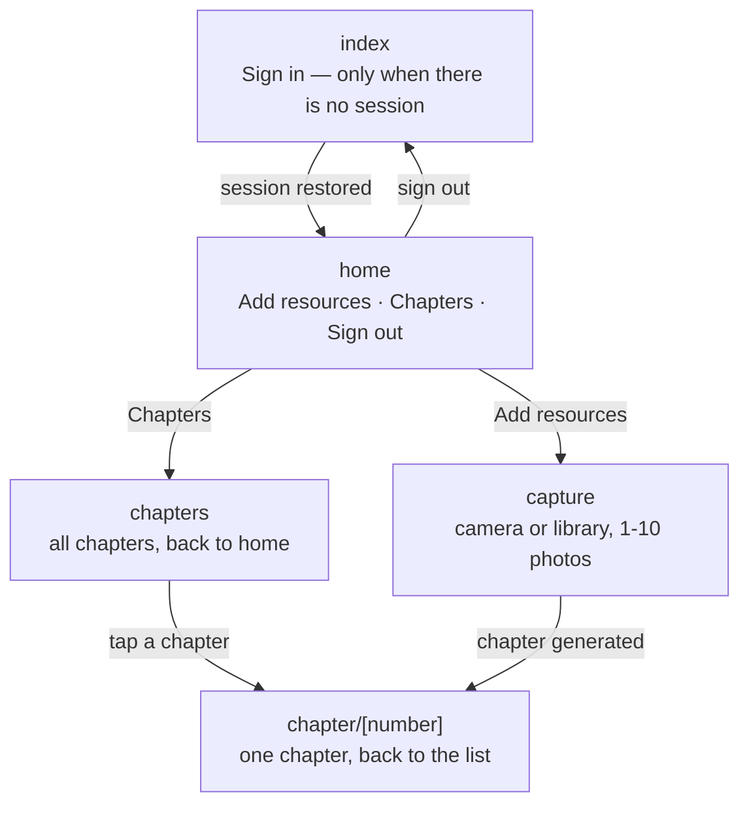

# Vocabula

**Personalized stories for language learners.**
Photograph your study material, and Vocabula writes the next chapter of your own story using the vocabulary and grammar you've just acquired — continuing from where your story left off.

This is the mobile app (React Native / Expo / TypeScript). The backend — ASP.NET Core on AWS (ECS Fargate, RDS PostgreSQL, Cognito, Terraform) — lives in the sibling repo [Pepert/Vocabula](https://github.com/Pepert/Vocabula) and is documented there.

## What this app does

- **Sign in** with Google, LinkedIn, or email — via Amazon Cognito's hosted UI (OAuth authorization-code flow with PKCE)
- **Add learning material**: photograph a notebook page; the backend extracts vocabulary and grammar using the Mistral OCR API
- **Read your story**: each new photo generates the next chapter, continuing from the previous one. New vocabulary appears in colour — blue if the story introduced it, green when it's from your notebook — tap any for its definition
- **Story history**: re-read your chapters, newest last

## Stack

| Layer | Tech |
|---|---|
| App | React Native 0.88, Expo SDK 58, TypeScript |
| Navigation | Expo Router (file-based) |
| Auth | `expo-auth-session` — Cognito hosted UI, PKCE, tokens in `expo-secure-store` (device keychain) |
| Backend API | ASP.NET Core at [api.vocabula.dev](https://api.vocabula.dev/swagger) |

## Structure

- `src/app/` — screens (Expo Router: each file is a route)
- `src/auth.ts` — session storage (keychain)
- `src/api.ts` — API client with token refresh
- `src/config.ts` — API and Cognito coordinates

## Page flow

The learner journey across the app's five routes:

Full route-by-route behavior: [docs/page-flow.md](docs/page-flow.md) ·
Design charter: [docs/design.md](docs/design.md) ·
For local development (Xcode, running on a physical iPhone, the sign-in flow), see [docs/local-development.md](docs/local-development.md).
