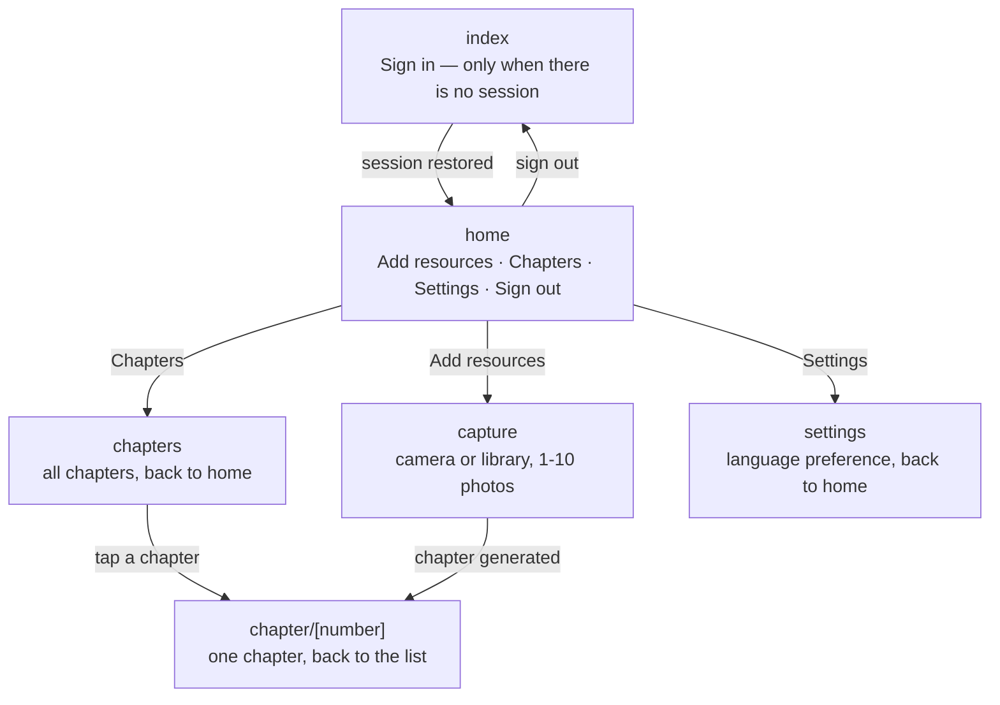

# Page flow

The app has six routes (Expo Router - each file under `src/app/` is a route):

## Behavior details

- **`index` (sign-in)** is the root route. It immediately redirects to `home`
  when a session exists in the keychain, so sign-in only shows up when there
  is no valid session (first launch, sign-out, or an expired session after a
  failed token refresh).
- **`home`** shows the story status of the active learning language and
  offers the two product actions. When no learning language is chosen yet,
  the actions are replaced by a single "Choose a language" button to
  Settings, since the backend refuses extraction without a choice. API
  tokens are cleared before routing to `index` on session expiry.
- **`capture`** handles the flow in two steps. Picking (camera, one shot at
  a time, or library, up to 10) lands on a review screen: the selection is
  shown as thumbnails that can be removed individually, with "take another
  photo" and "add from library" while below the 10-photo cap. Only the
  "Use these pictures" confirmation starts the upload - extraction and
  generation progress states unchanged, with a back button to home while
  picking or reviewing. On success it redirects to the freshly generated
  chapter page (the last chapter number) - the chapter is never displayed
  on the capture screen itself. After a failed upload the review is
  restored, so the session's picks are not lost.
- **`chapters`** lists every chapter in reading order. Each row opens the
  chapter page; the screen has a back button to home.
- **`chapter/[number]`** shows a single chapter. Its back button returns to
  the chapters list. There is deliberately no "add more material" from here:
  new material is added from home or capture only.
- **`settings`** shows account-wide preferences. Today the "General"
  expandable section holds the learned language (`en`/`fr`/`es`/`sv`,
  applied server-side via `PATCH /api/users/me/learning-language`) and the
  UI language. Switching the learned language changes which chapters and
  knowledge the app shows; the daily chapter quota is shared across all
  languages. The UI language (`en`/`fr`) is also stored on the account
  (`PATCH /api/users/me`); before sign-in, the sign-in page's selector
  keeps the choice in memory and applies it at first sign-in.
- **Language resolution**: an account preference always wins; otherwise
  the pre-sign-in choice; otherwise the device language (French devices
  get French, everything else English).

## Future planned flows

- Dotted-underline on unknown vocabulary inside a chapter (from
  `potentiallyNewLanguage`), tap to show the definition.
