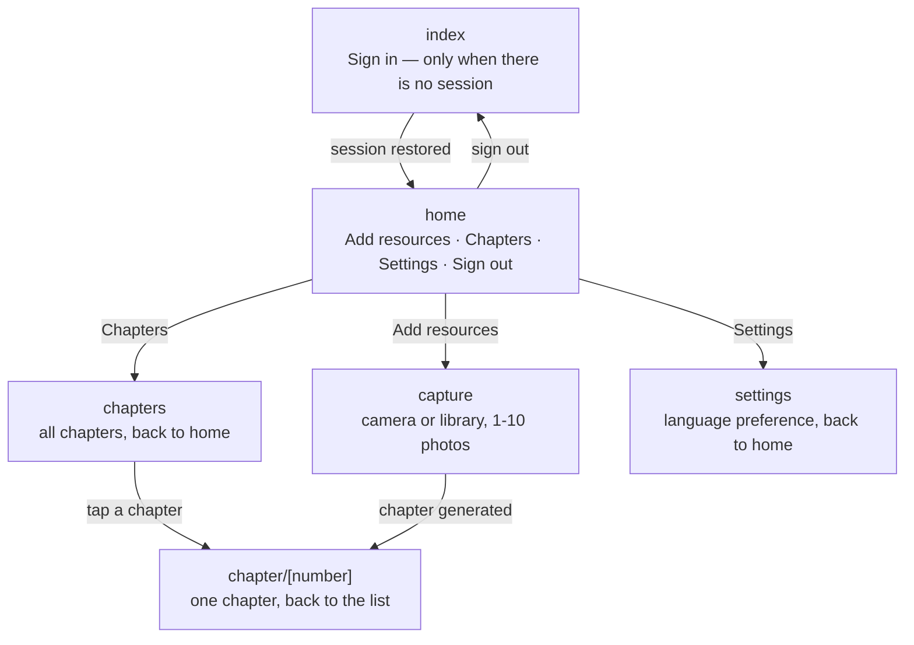

# Page flow

The app has six routes (Expo Router - each file under `src/app/` is a route):

## Behavior details

- **`index` (sign-in)** is the root route. It immediately redirects to `home`
  when a session exists in the keychain, so sign-in only shows up when there
  is no valid session (first launch, sign-out, or an expired session after a
  failed token refresh).
- **`home`** shows the story status and offers the two product actions.
  API tokens are cleared before routing to `index` on session expiry.
- **`capture`** handles the whole extraction/generation flow with progress
  states, and has a back button to home while picking. On success it
  redirects to the freshly generated chapter page (the last chapter
  number) - the chapter is never displayed on the capture screen itself.
- **`chapters`** lists every chapter in reading order. Each row opens the
  chapter page; the screen has a back button to home.
- **`chapter/[number]`** shows a single chapter. Its back button returns to
  the chapters list. There is deliberately no "add more material" from here:
  new material is added from home or capture only.
- **`settings`** shows account-wide preferences. Today it holds the UI
  language (`en`/`fr`) in a "General" expandable section; more sections
  (profile, account, plan…) will be added over time. The choice is stored
  on the account (`PATCH /api/users/me`) so it follows the user across
  devices; before sign-in, a language selector on the sign-in page keeps
  the choice in memory and applies it to the account at first sign-in.
- **Language resolution**: an account preference always wins; otherwise
  the pre-sign-in choice; otherwise the device language (French devices
  get French, everything else English).

## Future planned flows

- Dotted-underline on unknown vocabulary inside a chapter (from
  `potentiallyNewLanguage`), tap to show the definition.
